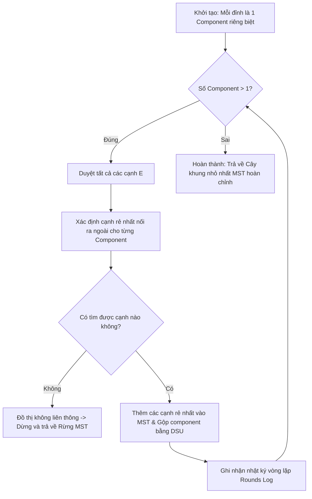

# TÀI LIỆU CHI TIẾT VỀ THUẬT TOÁN BORŮVKA (SOLLIN'S ALGORITHM)
> **Dự án:** Thiết kế mạng lưới vận chuyển thông minh (Shipping_DSA / Smart Delivery Network Design Using MST)  
> **Module:** `src/algorithms/boruvka.py` & `src/algorithms/dsu.py`  
> **Tài liệu phục vụ:** Báo cáo kỹ thuật, Phản biện thuật toán & Tích hợp hệ thống  

---

## 1. TỔNG QUAN & BỐI CẢNH LỊCH SỬ

### 1.1. Lịch sử ra đời
Thuật toán Borůvka được nhà toán học người Séc **Otakar Borůvka** công bố vào năm **1926**. Đây là **thuật toán tìm Cây khung nhỏ nhất (Minimum Spanning Tree - MST) đầu tiên trong lịch sử**, ra đời trước thuật toán Kruskal (1956) và Prim (1957) tới ba thập kỷ. 

Thuật toán ban đầu được thiết kế để giải quyết bài toán thực tế: **Tối ưu hóa chi phí xây dựng mạng lưới truyền tải điện cho vùng Moravia (Cộng hòa Séc)**. Về sau, Georges Sollin đã tái phát hiện và chuẩn hóa thuật toán này vào năm 1965, do đó nó còn có tên gọi là **Thuật toán Sollin**.

### 1.2. Ứng dụng trong bài toán mạng lưới vận chuyển (Shipping_DSA)
Trong đề tài thiết kế mạng lưới giao vận thông minh:
- **Đỉnh (Nodes):** Các trung tâm kho tổng (Central Hub), kho phân loại (Sorting Hub), và bưu cục giao nhận (Delivery Post).
- **Cạnh (Edges):** Các tuyến đường vận chuyển tiềm năng với trọng số là chi phí đầu tư tuyến đường hoặc khoảng cách di chuyển.
- **Mục tiêu Borůvka:** Kết nối toàn bộ các trung tâm logistics thành một mạng lưới liên thông với tổng chi phí xây dựng/vận hành tối thiểu, đảm bảo không có tuyến đường dư thừa gây lãng phí (không tạo chu trình).

---

## 2. CƠ SỞ TOÁN HỌC & TÍNH CHẤT CẮT (CUT PROPERTY)

Tính đúng đắn của thuật toán Borůvka dựa trên **Tính chất lát cắt (Cut Property)** trong lý thuyết đồ thị:

```
                  Lát cắt (Cut) ngăn cách 2 tập đỉnh
          Tập đỉnh S                          Tập đỉnh V \ S
       +--------------+                    +------------------+
       |   (Nút u)    |                    |     (Nút v)      |
       |      o-------+-------- e* --------+--------o         |
       |              |   (Cạnh nhẹ nhất)  |                  |
       +--------------+                    +------------------+
```

> **Định lý Tính chất cắt (Cut Property):**  
> Cho một đồ thị liên thông có trọng số $G = (V, E)$. Với bất kỳ một lát cắt $(S, V \setminus S)$ nào của $G$, nếu cạnh $e^* = (u, v)$ là cạnh có trọng số nhỏ nhất kết nối giữa một đỉnh thuộc $S$ và một đỉnh thuộc $V \setminus S$, thì cạnh $e^*$ **chắc chắn thuộc mọi Cây khung nhỏ nhất (MST)** của đồ thị $G$ (giả thiết các trọng số phân biệt).

**Áp dụng vào Borůvka:**
Ở mỗi vòng lặp, mỗi thành phần liên thông (component) đóng vai trò là một tập đỉnh $S$. Thuật toán luôn chọn cạnh nhẹ nhất nối từ $S$ ra ngoài ($V \setminus S$). Theo Cut Property, cạnh này an toàn 100% để thêm vào MST.

---

## 3. NGUYÊN LÝ HOẠT ĐỘNG CHI TIẾT (ROUND-BY-ROUND)

Khác với Prim (phát triển từ 1 đỉnh đơn lẻ) hay Kruskal (xét từng cạnh theo thứ tự sắp xếp tăng dần), Borůvka hoạt động theo phương thức **co cụm song song đồng thời (Parallel Component Merging)** qua từng vòng (Round).



### Các bước thực hiện chi tiết:

1. **Khởi tạo:**
   - Mỗi đỉnh $v \in V$ khởi tạo là một thành phần liên thông riêng biệt ($V$ components).
   - Khởi tạo tập cạnh của cây khung $MST = \emptyset$.
   - Khởi tạo cấu trúc `DisjointSetUnion` (DSU) để theo dõi các tập hợp đỉnh.

2. **Vòng lặp (Mỗi Round):**
   - Tạo một bảng tra cứu `cheapest` lưu cạnh tốt nhất cho từng component đại diện.
   - **Quét toàn bộ danh sách cạnh:**
     - Với mỗi cạnh $e = (u, v, w)$, tìm gốc đại diện $R_u = \text{find}(u)$ và $R_v = \text{find}(v)$.
     - Nếu $R_u == R_v$: Bỏ qua (cạnh nội bộ cùng một cụm).
     - Nếu $R_u \ne R_v$:
       - So sánh và cập nhật $e$ làm cạnh rẻ nhất của component $R_u$ nếu $e$ tốt hơn cạnh hiện tại.
       - Tương tự, so sánh và cập nhật $e$ làm cạnh rẻ nhất của component $R_v$.
   - **Kết nạp cạnh vào MST:**
     - Duyệt qua tất cả các cạnh rẻ nhất vừa tìm được trong bảng `cheapest`.
     - Với mỗi cạnh $(u, v)$, thực hiện `dsu.union(u, v)`. Nếu phép gộp thành công (chưa bị cạnh khác gộp trước đó trong cùng vòng), thêm cạnh vào danh sách kết quả `mst_edges` và cộng dồn trọng số.
   - **Ghi log vòng lặp:** Lưu lại số component trước/sau, danh sách cạnh kết nạp để phục vụ trực quan hóa (animation).

3. **Điều kiện dừng:**
   - Chỉ còn đúng **1 component duy nhất** $\rightarrow$ Đồ thị liên thông, tìm thấy MST hoàn chỉnh.
   - **Không tìm thấy cạnh nào kết nối ra ngoài** giữa các component $\rightarrow$ Đồ thị ban đầu không liên thông, thuật toán dừng lại và trả về **Rừng cây khung nhỏ nhất (MST Forest)**.

---

## 4. ĐỘ PHỨC TẠP TÍNH TOÁN & KHÔNG GIAN

### 4.1. Số lượng vòng lặp (Iterations)
- Ở mỗi vòng, mỗi component đều kết nối với ít nhất một component khác.
- Do đó, sau mỗi vòng lặp, số lượng component giảm đi **ít nhất một nửa**:
  $$\text{Số components sau vòng } k \le \frac{V}{2^k}$$
- Số vòng lặp tối đa của Borůvka chỉ là:
  $$\text{Số Rounds} \le \lceil \log_2 V \rceil$$

### 4.2. Độ phức tạp thời gian (Time Complexity)
- Mỗi vòng lặp duyệt qua toàn bộ $E$ cạnh. Với mỗi cạnh, thực hiện thao tác DSU `find` tốn $O(\alpha(V))$ (hàm Ackermann nghịch đảo, xấp xỉ hằng số $\le 4$).
- Thao tác gộp đỉnh và cập nhật: $O(V \cdot \alpha(V))$.
- Chi phí cho mỗi vòng: $O(E \cdot \alpha(V))$.
- Tổng thời gian qua tối đa $\log_2 V$ vòng:
  $$\mathcal{O}(E \log V)$$

### 4.3. Độ phức tạp không gian (Space Complexity)
- Cấu trúc DSU: $O(V)$ cho mảng cha (`parent`) và hạng (`rank`).
- Bảng cạnh rẻ nhất `cheapest`: tối đa $O(V)$ phần tử.
- Lưu trữ cạnh chuẩn hóa: $O(E)$.
- Tổng không gian:
  $$\mathcal{O}(V + E)$$

### 4.4. Ưu thế song song hóa (Parallelization Advantage)
Điểm vượt trội lớn nhất của Borůvka so với Kruskal và Prim là **khả năng chạy song song tự nhiên**:
- Việc tìm cạnh rẻ nhất cho mỗi component có thể phân bổ độc lập cho nhiều luồng CPU / GPU hoặc máy phân tán (MapReduce / Apache Spark).
- Đây là lý do Borůvka là thuật toán MST được ứng dụng phổ biến nhất trong điện toán song song và xử lý đồ thị quy mô lớn (Large-scale Distributed Graph Processing).

---

## 5. CÁC CHI TIẾT KỸ THUẬT QUAN TRỌNG TRONG SOURCE CODE

Code cài đặt nằm tại:
- [src/algorithms/boruvka.py](file:///c:/Dev_Uni/Shipping_DSA/src/algorithms/boruvka.py)
- [src/algorithms/dsu.py](file:///c:/Dev_Uni/Shipping_DSA/src/algorithms/dsu.py)

### 5.1. Cơ chế chống chu trình khi trọng số bằng nhau (Tie-Breaking)
**Vấn đề:** Nếu đồ thị có nhiều cạnh cùng trọng số (ví dụ đồ thị hình vuông có 4 cạnh đều bằng 2), hai component $C_1$ và $C_2$ có thể cùng chọn cạnh nối sang $C_3$, vô tình tạo thành một chu trình khép kín $C_1 - C_2 - C_3 - C_1$.

**Giải pháp trong code:**
Gán cho mỗi cạnh một định danh duy nhất `edge_id` (chỉ số xuất hiện ban đầu) và so sánh theo bộ tuple `(weight, edge_id)`:
```python
# So sánh theo tuple (weight, edge_id) để đảm bảo tính thứ tự toàn phần (Strict Weak Ordering)
if root_u not in cheapest or (edge.weight, edge.edge_id) < (
    cheapest[root_u].weight,
    cheapest[root_u].edge_id,
):
    cheapest[root_u] = edge
```
Nhờ cơ chế này, mọi cạnh đều có độ ưu tiên phân biệt tuyệt đối, đảm bảo tính chất không tạo chu trình toán học.

### 5.2. Xử lý Cạnh khuyên (Self-Loops) và Cạnh song song (Parallel Edges)
- **Cạnh khuyên ($u == v$):** Bị hàm `_normalize_edge` loại bỏ ngay từ bước tiền xử lý vì khuyên không bao giờ thuộc bất kỳ cây khung nào.
- **Cạnh song song:** Nếu giữa $u$ và $v$ có nhiều cạnh (ví dụ một tuyến cao tốc và một tuyến đường nội đô), vòng lặp so sánh sẽ tự động giữ lại cạnh có `weight` nhỏ nhất.

### 5.3. Xử lý Đồ thị không liên thông (Disconnected Graphs & MST Forest)
Nếu đồ thị vận chuyển bị chia cắt thành các đảo cô lập (ví dụ không có tuyến nối giữa đất liền và hải đảo):
```python
# Nếu không còn cạnh nào kết nối giữa các component khác nhau -> Đồ thị bị chia cắt
if not cheapest:
    break
```
Thuật toán sẽ an toàn thoát ra, trả về:
- `is_connected = False`
- `num_components > 1`
- `mst_edges`: Tập hợp các cây khung con (Rừng MST) kết nối tối đa có thể trong từng vùng.

### 5.4. Tối ưu hóa DSU với Path Compression & Union by Rank
Lớp `DisjointSetUnion` trong [src/algorithms/dsu.py](file:///c:/Dev_Uni/Shipping_DSA/src/algorithms/dsu.py) cài đặt 2 kỹ thuật tối ưu hóa kinh điển:
1. **Path Compression (Nén đường đi):** Trong hàm `find()`, mọi nút trên đường đi tìm gốc được trỏ trực tiếp về gốc đại diện, giúp cây luôn có độ sâu gần như $O(1)$.
2. **Union by Rank (Hợp nhất theo hạng):** Trong hàm `union()`, cây có độ sâu thấp hơn luôn được gán làm con của cây có độ sâu cao hơn, ngăn chặn hiện tượng cây suy biến thành danh sách liên kết.

---

## 6. SO SÁNH: BORŮVKA VS KRUSKAL VS PRIM

| Tiêu chí | Borůvka (Sollin) | Kruskal | Prim |
| :--- | :--- | :--- | :--- |
| **Chiến lược tiếp cận** | Co cụm song song các component | Tham lam xét từng cạnh toàn cục | Phát triển dần từ 1 đỉnh đơn lẻ |
| **Cấu trúc dữ liệu chính** | DSU + Mảng ánh xạ Component | DSU + Sắp xếp danh sách cạnh | Hàng đợi ưu tiên (Min-Heap / PriorityQueue) |
| **Độ phức tạp thời gian** | $\mathcal{O}(E \log V)$ | $\mathcal{O}(E \log E) = \mathcal{O}(E \log V)$ | $\mathcal{O}(E + V \log V)$ (với Fibonacci Heap) hoặc $\mathcal{O}(E \log V)$ |
| **Đồ thị thích hợp nhất** | Mọi loại đồ thị, đặc biệt đồ thị phân tán | Đồ thị thưa ($E \approx V$) | Đồ thị dày ($E \approx V^2$) |
| **Khả năng song song hóa** | **Rất cao (Tự nhiên)** | Thấp (do bước duyệt tuần tự cạnh) | Rất thấp (phát triển tuần tự từng đỉnh) |
| **Xử lý đồ thị rời rạc** | Tự động tạo Rừng MST (Forest) | Tự động tạo Rừng MST (Forest) | Cần khởi động lại thuật toán cho từng component |

---

## 7. HƯỚNG DẪN SỬ DỤNG TRONG DỰ ÁN

### 7.1. Chạy trên danh sách cạnh tùy biến
```python
from src.algorithms.boruvka import boruvka_mst

edges = [
    {"u": "Kho_Bac_Tu_Liem", "v": "Kho_Cau_Giay", "weight": 4.5},
    {"u": "Kho_Cau_Giay", "v": "Hub_Long_Bien", "weight": 11.2},
    {"u": "Kho_Bac_Tu_Liem", "v": "Hub_Long_Bien", "weight": 14.8},
    {"u": "Kho_Dong_Da", "v": "Kho_Cau_Giay", "weight": 3.8},
]

result = boruvka_mst(edges)

print(f"Tổng chi phí mạng lưới: {result.total_weight:.2f}")
print(f"Số cạnh được xây dựng: {len(result.mst_edges)}")
print(f"Mạng lưới liên thông hoàn chỉnh: {result.is_connected}")
```

### 7.2. Chạy trên file Dataset JSON chuẩn
```python
from src.algorithms.boruvka import boruvka_from_json

# Đọc và giải bài toán trên dataset mạng lưới bưu chính Hà Nội
result = boruvka_from_json("data/reallife_data/hanoi_network.json")

print(f"Tổng trọng số MST Hà Nội: {result.total_weight}")
for edge in result.mst_edges:
    print(f"  {edge['u']} <---> {edge['v']} (Chi phí: {edge['weight']})")
```

### 7.3. Chạy kiểm thử tự động (Unit Tests)
Dự án cung cấp bộ test tự động tại [tests/test_boruvka.py](file:///c:/Dev_Uni/Shipping_DSA/tests/test_boruvka.py) với 7 bài kiểm thử đối soát chéo độc lập với NetworkX:
```bash
# Chạy trực tiếp file test
python tests/test_boruvka.py

# Hoặc chạy thông qua pytest
python -m pytest tests/test_boruvka.py -v
```
